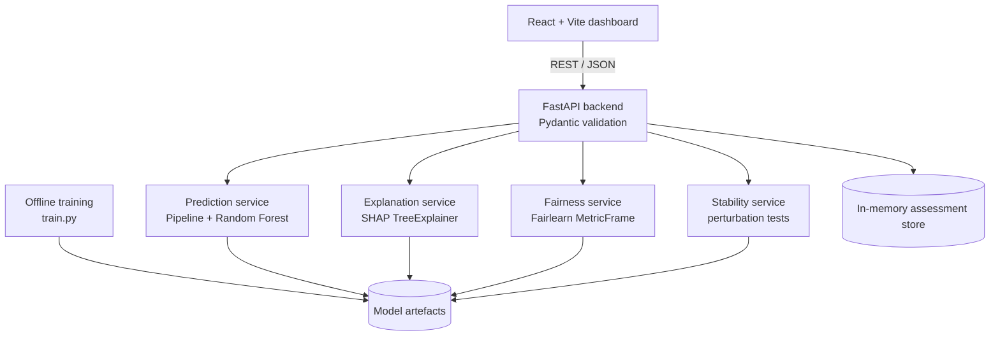

# Research Paper — Explainable Credit Risk Assessment

**Title:** *Beyond the Approve/Reject Label: An Explainable, Fairness-Audited and Stability-Tested Machine Learning Framework for Credit Risk Assessment*

## Files

| File | Purpose |
|---|---|
| `research_paper.docx` | Submission-ready Word version (A4, Times New Roman, IEEE-style numbered references). Edit author details here. |
| `research_paper.md` | Master source of the paper (all other formats are generated from it). |
| `research_paper.tex` / `research_paper.pdf` | LaTeX version and its compiled PDF (XeLaTeX; also compiles on Overleaf). |
| `references.bib` | All 27 references in BibTeX, in citation order. |
| `figures/` | Fig. 1 methodology, Fig. 2 architecture, Fig. 3 model comparison, Fig. 4 SHAP importance, Fig. 5 fairness. `equations/` holds equation images used only by the DOCX. |
| `results/` | Raw evidence behind every number in the paper: `model_metadata.json` (training output), `fairness_report.json`, `stability_eval_output.txt`, `demo_applicant_explanations.json`. |
| `scripts/` | `make_figures.py`, `stability_eval.py`, `build_docx_md.py`, `polish_docx.py`, `build.sh`, `reference.docx` (Word style template). |

## Where the numbers come from

All results were produced by the implemented system with the model trained on the team's PC (`backend/models/metadata.json`, 6 Oct 2026, seed 42). Nothing in the paper is estimated or invented.

| Paper item | Source |
|---|---|
| Tables I–III, Fig. 3 | `results/model_metadata.json` (`comparison`, `selected_metrics`) |
| Fig. 4 | `results/model_metadata.json` (`global_importance`) |
| Table IV | `results/demo_applicant_explanations.json` ("borderline") |
| Table V | `results/stability_eval_output.txt` (re-run with `scripts/stability_eval.py`) |
| Tables VI–VII, Fig. 5 | `results/fairness_report.json` (same as the API's `GET /fairness`) |

If the model is retrained with different library versions, small changes are possible. In that case re-run the scripts and update the tables.

## Rebuilding

```bash
# figures (from project root paths)
python scripts/make_figures.py <project-root> figures results/fairness_report.json
# stability numbers (run from <project-root>/backend)
python ../paper/scripts/stability_eval.py
# docx + tex + pdf from research_paper.md
bash scripts/build.sh
```

## Before submitting

1. Replace `[Author 1 Name] …`, the affiliation line and `[email addresses]` in the DOCX (and in `research_paper.md` if you rebuild).
2. Add your guide's name if your department requires it (e.g. "Under the guidance of …").
3. Optionally add 1–2 dashboard screenshots (Credit Assessment result, Fairness page) as extra figures in Section 16.
4. Read the whole paper and rewrite any sentence in your own words where you would explain it differently in the viva.
5. Run the college plagiarism check (Turnitin or equivalent); exclude the reference list if allowed. Target < 10%.
6. Upload to VTOP (Assessment 6) by 14-10-2026.

## Architecture diagram source (Mermaid)


