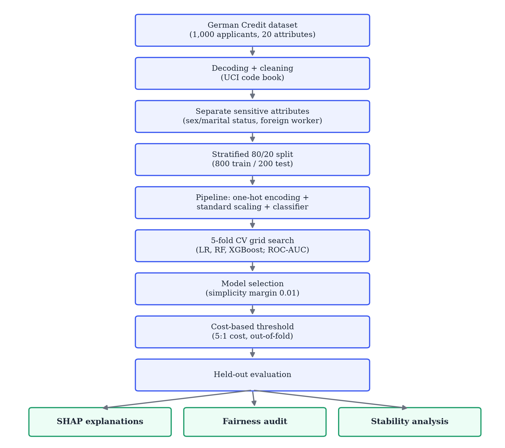
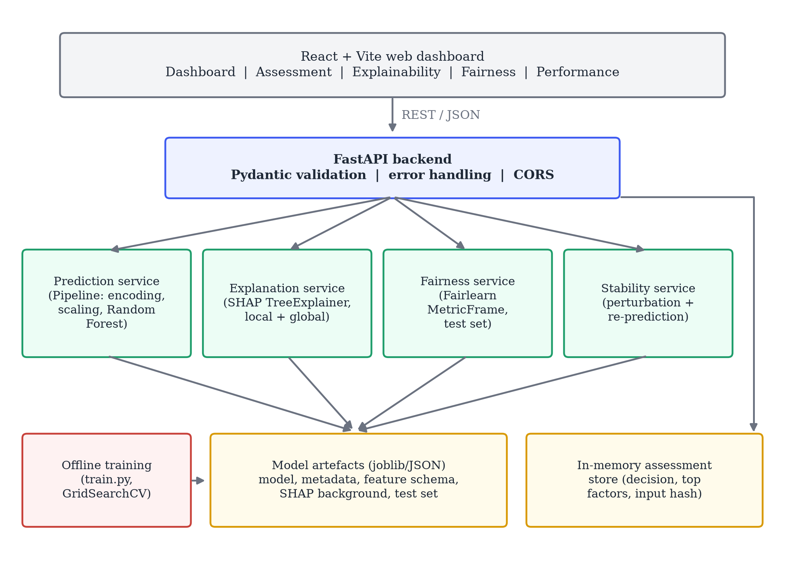
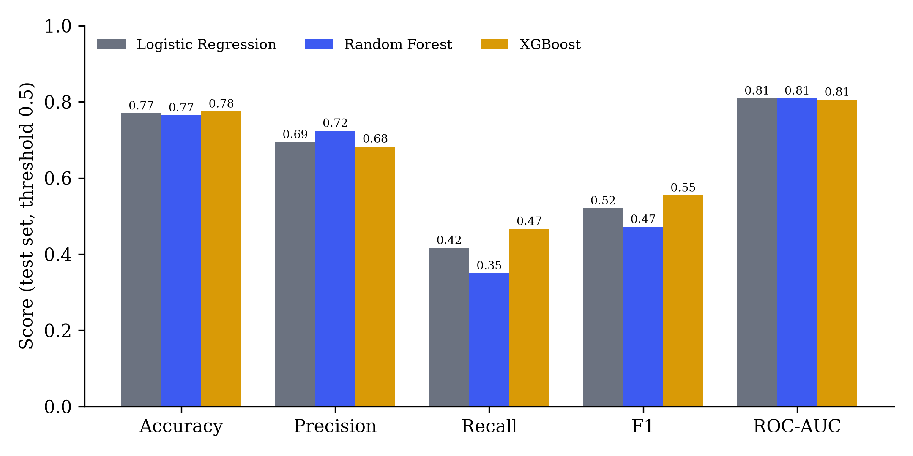
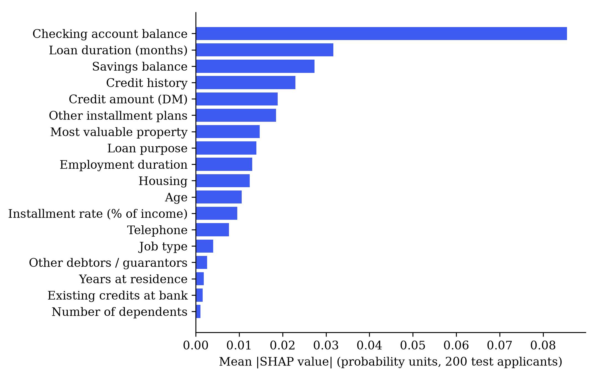
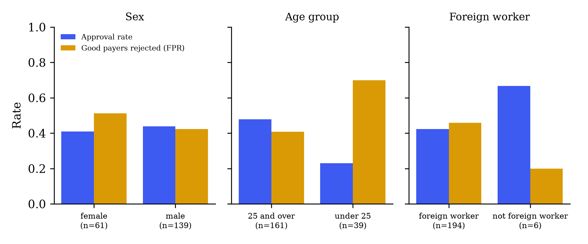

# Abstract

Lenders increasingly rely on machine-learning (ML) models to estimate the probability that a borrower will default, yet a model that returns only "approve" or "reject" gives applicants, credit officers and regulators little basis for trust, challenge or audit. This paper presents an academic prototype that couples credit-risk prediction with three supporting analyses: post-hoc explanation, group-fairness auditing and prediction-stability testing. Using the Statlog German Credit dataset (1,000 applicants, 30% labelled as bad credit), we compare logistic regression, random forest and XGBoost inside a leakage-free preprocessing pipeline tuned by five-fold cross-validation. A random forest was selected because its cross-validated ROC-AUC (0.792) was within 0.01 of the best model (XGBoost, 0.797) while being the simpler of the two ensembles. Because the dataset's documentation assigns five times more cost to approving a bad borrower than to rejecting a good one, the decision threshold was set to 0.27 using out-of-fold training predictions. On a held-out test set of 200 applicants the model achieves ROC-AUC 0.809, recall 0.850, precision 0.447, F1 0.586 and accuracy 0.640. SHAP values provide applicant-level and global explanations; checking-account status, loan duration and savings were the most influential features. A Fairlearn audit shows that applicants under 25 receive a markedly lower approval rate (23.1%) than older applicants (47.8%), and that creditworthy women are wrongly rejected more often than creditworthy men (51.2% vs 42.4%), even though sex is not a model input. A perturbation test found that 96.5% of test applicants kept the same decision under ±5% changes to loan amount and duration. The system is delivered as a FastAPI service with a React dashboard. It is a research prototype trained on small historical data, not a production lending system, and its fairness findings are reported as identified disparities rather than as evidence of a fair model.

**Keywords** — credit risk assessment, explainable artificial intelligence, SHAP, algorithmic fairness, Fairlearn, random forest, cost-sensitive classification, prediction stability

# 1. Introduction

Credit risk assessment is the task of estimating how likely an applicant is to fail to repay a loan. The estimate drives whether credit is granted, how much is lent and at what price, so errors are costly in both directions: approving applicants who later default produces direct losses, while rejecting applicants who would have repaid denies them access to finance and reduces the lender's business.

Historically, this judgement was made by loan officers following institutional guidelines, later supported by statistical scorecards built mainly on logistic regression. Scorecards remain popular precisely because each variable's contribution to the score can be read off directly. Over the last two decades, however, a large body of benchmarking work has shown that ensemble learners such as random forests and gradient boosting often rank applicants more accurately than single statistical models [1], [2], [3]. Lending institutions have accordingly moved towards these more flexible, but less transparent, models.

This shift raises three concerns that predictive accuracy alone does not address.

1. **Explainability.** Ensemble models combine hundreds of decision trees, so the reason behind any single decision is not visible. Applicants refused credit, the officers who handle their cases and the supervisors who audit lenders all need to understand which factors drove a decision. Rudin argues that opaque models are especially problematic for high-stakes decisions [4], and post-hoc tools such as LIME [5] and SHAP [6] have been developed partly in response.
2. **Fairness.** A model trained on historical lending outcomes can reproduce or amplify past disparities between demographic groups, even when protected attributes are removed, because other variables can act as proxies [7], [8]. Empirical work on mortgage data has shown that more flexible ML models can change outcomes unevenly across groups [9].
3. **Stability.** If a negligible change in an input, such as a slightly different loan amount, reverses a decision, then the decision is fragile and difficult to defend. Explanation methods themselves have also been shown to be sensitive to small perturbations [10], [11].

These concerns are usually studied separately: predictive benchmarks focus on accuracy, explainability studies on interpretation, and fairness studies on group metrics. This project brings them together in a single, working prototype. For every applicant, the system reports a risk prediction and probability, a SHAP-based explanation, and a stability check; at the model level it reports evaluation metrics, global feature importance and a group-fairness audit. All results in this paper are produced by that implementation.

The remainder of the paper is organised as follows. Sections 2–4 state the problem, objectives and research questions. Sections 5–6 review related work and identify the gap addressed. Sections 7–14 describe the dataset and methods, and Sections 15–16 the system. Sections 17–19 report and discuss results. Sections 20–23 cover limitations, current progress, conclusions and future work.

# 2. Problem Statement

Given the attributes of a loan applicant, the system must estimate the probability that the applicant will be a bad credit risk and convert that estimate into a decision. The decision must be accompanied by (a) an explanation of which applicant attributes increased or decreased the estimated risk, (b) evidence on whether the model's decisions differ systematically between demographic groups, and (c) evidence on whether the decision changes under small, plausible variations of the applicant's numeric inputs. The model must be evaluated with metrics that reflect the unequal cost of the two kinds of error, rather than with accuracy alone.

# 3. Research Objective

**Main objective.** To design, implement and evaluate a credit-risk assessment framework in which every prediction is accompanied by an interpretable explanation, the model's behaviour is audited across demographic groups, and the robustness of individual decisions to small input changes is measured.

The objective is broken into the following measurable sub-objectives:

- **O1 — Prediction:** train and compare at least three classifiers using cross-validation and report accuracy, precision, recall, F1 and ROC-AUC on an untouched test set.
- **O2 — Cost-aware decisions:** derive a decision threshold from the dataset's asymmetric misclassification costs without using test data.
- **O3 — Explainability:** produce local (per-applicant) and global SHAP explanations expressed in terms of the original applicant attributes.
- **O4 — Fairness auditing:** measure approval rates, error rates, demographic parity difference and equalized odds difference for available sensitive attributes, and report sample-size limitations.
- **O5 — Stability:** quantify how often decisions change under small perturbations of non-sensitive numeric features, and identify the features to which decisions are most sensitive.
- **O6 — Integration:** expose all of the above through a documented REST API and an interactive web dashboard.

# 4. Research Questions

- **RQ1.** How well can standard ML classifiers rank and classify credit risk on the German Credit dataset, and how much does the choice of model matter?
- **RQ2.** Which applicant attributes drive the selected model's predictions globally, and can SHAP values give consistent, human-readable explanations for individual decisions?
- **RQ3.** Do the model's decisions differ across age, sex and foreign-worker groups, and how reliable are such measurements on a dataset of this size?
- **RQ4.** How stable are individual decisions when loan amount and duration are perturbed slightly, and which features are most likely to flip a decision?
- **RQ5.** Can prediction, explanation, fairness auditing and stability testing be integrated into a single practical system without compromising the evaluation protocol?

# 5. Related Work

## 5.1 Machine learning for credit scoring

Baesens et al. [1] compared a wide range of classifiers on eight real credit datasets and found that several methods, including neural networks and support vector machines, performed well, but that simple logistic regression and linear discriminant analysis were often competitive. More than a decade later, Lessmann et al. [2] updated this benchmark with 41 classifiers and several performance measures, and reported that heterogeneous ensembles and random forests tended to outperform the industry-standard logistic regression. Dastile et al. [3] systematically surveyed statistical and ML credit-scoring studies from the preceding decade and found ensemble approaches to be among the most frequently reported strong performers. The random forest [12] and XGBoost [13] algorithms used in this work are among the most widely applied ensemble methods in this literature.

## 5.2 The German Credit dataset

The Statlog German Credit dataset donated by Hofmann [14] is one of the most commonly used public credit datasets in ML research, partly because it is small, complete and ships with a cost matrix. It is also widely used in the fairness literature because it contains age, sex and foreign-worker information; Kamiran and Calders, for example, used it to evaluate pre-processing techniques for discrimination-aware classification [15]. Grömping later documented serious coding errors in the original attribute descriptions and released a corrected "South German Credit" version [16]. We use the original data for comparability with prior work and discuss the implications in Section 20.

## 5.3 Explainable AI in credit decisions

Doshi-Velez and Kim [17] argue that interpretability should be treated as a measurable property connected to concrete needs, such as detecting bias or justifying decisions. Model-agnostic post-hoc methods approximate a complex model's behaviour around a particular input: LIME fits a local surrogate model [5], while SHAP attributes a prediction to features using Shapley values from cooperative game theory and unifies several earlier attribution methods [6]. Lundberg et al. later developed an exact, polynomial-time algorithm for tree ensembles (TreeSHAP) and showed how local explanations can be aggregated into global insight [18]. In credit risk specifically, Bussmann et al. [19] combined gradient-boosted trees with Shapley values to explain credit-risk predictions on peer-to-peer lending data, grouping borrowers by the similarity of their explanations. In contrast, Rudin [4] cautions that post-hoc explanations of black boxes can be incomplete or misleading, and recommends inherently interpretable models where they perform comparably.

## 5.4 Fairness in machine learning and lending

Mehrabi et al. [7] survey the sources of bias in ML systems and the many definitions of fairness proposed to measure it. Two group-level definitions are used in this work. Demographic parity compares the rate of favourable decisions across groups, whereas equalized odds, introduced by Hardt et al. [20], requires equal true-positive and false-positive rates across groups. Kleinberg et al. [21] and Chouldechova [22] showed that, when base rates differ between groups, calibration and equal error rates generally cannot be achieved simultaneously, so any fairness assessment involves trade-offs and must state which definition it uses. Barocas et al. [8] discuss why simply removing protected attributes ("fairness through unawareness") is insufficient. In credit markets, Fuster et al. [9] found that more flexible ML models increased predicted default-risk disparities across racial and ethnic groups in US mortgage data. Fairlearn is an open-source toolkit that implements group fairness metrics and mitigation algorithms [23], and is used in our audit.

## 5.5 Robustness and stability

The adversarial-examples literature demonstrates that small, targeted input changes can alter the output of an ML model [24]. For tabular credit data, a related but more modest question is whether a decision is stable under small, realistic variations of the applicant's numbers. Alvarez-Melis and Jaakkola [10] showed that several interpretability methods produce noticeably different explanations for nearly identical inputs, and Slack et al. [11] demonstrated that LIME and SHAP explanations can be deliberately manipulated. These findings motivate checking the stability of decisions alongside their explanations.

# 6. Research Gap

The reviewed work shows strong progress on each concern separately. Large benchmarks [1]–[3] concentrate on predictive performance; explainability studies such as [19] focus on interpreting a model; and fairness studies [7]–[9], [15], [20]–[22] focus on group metrics and their trade-offs. In student and practitioner projects, these components are typically produced as separate notebooks, and evaluation details such as threshold choice and data leakage are often left implicit.

We do not claim that combining these techniques is new in itself. The gap we address is practical: there are few openly documented, end-to-end prototypes in which (i) model selection and threshold choice are made on training data only and justified by the dataset's cost structure, (ii) every individual decision is returned together with its SHAP explanation and a stability check, and (iii) a group-fairness audit with explicit sample-size caveats is part of the same deployed service. This project provides such a prototype and reports its measured behaviour, including unfavourable findings.

# 7. Proposed Methodology

Fig. 1 summarises the pipeline. The data are decoded and cleaned, sensitive attributes are separated from model inputs, and the dataset is split once into stratified training (80%) and test (20%) sets. All preprocessing is fitted inside a scikit-learn [25] `Pipeline`, so cross-validation never sees statistics computed on its own validation folds. Three candidate models are tuned by grid search with five-fold stratified cross-validation, one model is selected, and a decision threshold is chosen from out-of-fold training predictions. The test set is then used once for final evaluation, explanation, fairness auditing and stability analysis.

{width=80%}

# 8. Dataset Description

The Statlog German Credit dataset [14] contains 1,000 loan applicants described by 20 attributes and a binary target: 700 applicants are labelled good credit risks and 300 bad. Seven attributes are numeric (loan duration in months, credit amount, installment rate as a percentage of disposable income, years at current residence, age, number of existing credits at the bank and number of dependants) and thirteen are categorical (checking-account status, credit history, loan purpose, savings, employment duration, personal status and sex, other debtors or guarantors, property, other installment plans, housing, job, telephone and foreign-worker status). Monetary values are in Deutsche Mark (DM). There are no missing values.

The raw file encodes categorical values as symbolic codes (for example `A11` for a checking-account balance below 0 DM). We decode these using the code book distributed with the dataset so that model inputs, explanations and the user interface use readable values.

**Sensitive attributes.** The dataset contains three attributes commonly treated as sensitive: *personal status and sex*, *age* and *foreign worker*. The personal-status attribute mixes marital status and sex, and the code for "female, single" does not occur in the data; we therefore derive a binary `sex` variable (female / male) for auditing only. Only 37 of the 1,000 applicants are not foreign workers. The dataset documentation also supplies a cost matrix in which classifying a bad applicant as good costs 5 and classifying a good applicant as bad costs 1 [14].

# 9. Data Preprocessing

1. **Decoding and validation.** Every symbolic code is mapped to its documented meaning; an unknown code raises an error rather than being silently accepted.
2. **Target.** The original label (1 = good, 2 = bad) is converted to `is_bad` $\in \{0, 1\}$, so the positive class is the high-risk outcome.
3. **Cleaning.** Duplicates are removed (none were found) and numeric columns are type-checked. Median and mode imputation are included for robustness, although the dataset has no missing values.
4. **Sensitive-attribute handling.** `personal_status_sex` and `foreign_worker` are excluded from the model inputs and retained only for the fairness audit. Age is kept as a model feature, because it is widely used in credit scoring, but it is audited explicitly. The model therefore uses 18 features: 7 numeric and 11 categorical.
5. **Encoding and scaling.** Categorical features are one-hot encoded (unknown categories are ignored at prediction time) and numeric features are standardised, giving 55 model columns. Scaling is necessary for logistic regression and harmless for tree models, so one preprocessing definition is shared by all candidates.
6. **Split.** A stratified 80/20 split with a fixed random seed yields 800 training and 200 test applicants, preserving the 70/30 class ratio.

# 10. Machine Learning Models

**Logistic regression (LR)** models the log-odds of default as a linear function of the encoded features $\mathbf{x}$:

$$P(y=1 \mid \mathbf{x}) = \sigma(\mathbf{w}^\top \mathbf{x} + b) = \frac{1}{1 + e^{-(\mathbf{w}^\top \mathbf{x} + b)}}$$

with L2 regularisation strength controlled by $C$. It serves as the transparent baseline traditionally used in scorecards.

**Random forest (RF)** [12] averages the class-probability estimates of $T$ decision trees, each grown on a bootstrap sample of the training data with a random subset of features considered at each split:

$$\hat{p}(\mathbf{x}) = \frac{1}{T} \sum_{t=1}^{T} p_t(\mathbf{x})$$

Averaging many decorrelated trees reduces variance compared with a single tree.

**XGBoost** [13] builds trees sequentially, each fitted to the gradient of the loss of the current ensemble, with shrinkage (learning rate) and regularisation to control overfitting.

Hyper-parameter grids were kept small to suit the dataset size: $C \in \{0.01, 0.1, 0.3, 1, 3\}$ for LR; 300 trees with maximum depth $\in \{4, 8, \text{none}\}$ and minimum leaf size $\in \{1, 5\}$ for RF; and for XGBoost, 100 or 300 trees, maximum depth $\in \{2, 3, 4\}$, learning rate $\in \{0.03, 0.1\}$ and subsample 0.8.

# 11. Model Selection and Evaluation Metrics

## 11.1 Metrics

With $TP$, $FP$, $TN$ and $FN$ denoting true/false positives/negatives (positive = bad credit):

$$\text{Precision} = \frac{TP}{TP+FP}, \quad \text{Recall} = \frac{TP}{TP+FN}, \quad F_1 = \frac{2\,\text{Precision}\cdot\text{Recall}}{\text{Precision}+\text{Recall}}$$

ROC-AUC is the area under the curve of true-positive rate against false-positive rate as the threshold varies; it equals the probability that a randomly chosen bad applicant receives a higher risk score than a randomly chosen good applicant [26]. We also report the dataset's misclassification cost, $\text{Cost} = 5\,FN + 1\,FP$.

Accuracy alone is unsuitable here. Because 70% of applicants are good, a model that approves everyone reaches 70% accuracy while identifying no defaulters. Recall measures how many defaulters are caught; precision measures how many flagged applicants are truly risky; ROC-AUC measures ranking quality independently of any threshold.

## 11.2 Selection rule

Models were compared on mean five-fold cross-validated ROC-AUC computed on the training set only. The model with the highest score is selected unless a simpler model lies within 0.01 of it, in which case the simpler model is preferred (order of simplicity: LR, RF, XGBoost). This margin reflects the fact that differences smaller than about 0.01 AUC are well within the fold-to-fold variation for 800 training examples.

## 11.3 Cost-based decision threshold

A default threshold of 0.5 implicitly treats both errors as equally costly. Under the 5:1 cost matrix, decision theory suggests flagging an applicant when the expected cost of approval exceeds that of rejection, i.e. when $5p > 1(1-p)$, or $p > 1/6$, assuming perfectly calibrated probabilities [27]. Random-forest probabilities are not perfectly calibrated, so instead of using this theoretical value we search thresholds from 0.05 to 0.95 in steps of 0.01 and choose the one that minimises $5\,FN + FP$ on *out-of-fold* predictions for the training set (obtained with `cross_val_predict`). The test set plays no part in this choice.

For presentation, predicted probabilities are additionally grouped into three bands: **LOW** ($p <$ threshold), **MEDIUM** (threshold $\le p < 0.5$; flagged but borderline, recommended for human review) and **HIGH** ($p \ge 0.5$).

# 12. Explainable AI Using SHAP

SHAP [6] explains a prediction $f(\mathbf{x})$ as a sum of feature contributions added to a base value:

$$f(\mathbf{x}) = \phi_0 + \sum_{j=1}^{M} \phi_j$$

where $\phi_0$ is the expected model output over a background dataset and $\phi_j$ is the Shapley value of feature $j$, i.e. its average marginal contribution over all subsets of the other features. We use the TreeSHAP algorithm [18] in interventional mode with 100 randomly selected training applicants as background, and explain the model's output in probability units.

Because the model operates on one-hot encoded columns while users think in terms of original attributes, the SHAP values of all columns derived from the same attribute are summed. This is valid because Shapley values are additive. A positive value means the attribute pushed the estimated default probability **up** (towards high risk); a negative value means it pushed the probability **down**. Global importance is the mean absolute SHAP value of each attribute over the 200 test applicants. An automated test checks that $\phi_0 + \sum_j \phi_j$ reproduces the predicted probability to within 0.01.

# 13. Fairness Analysis

For each sensitive grouping $A$ — derived sex, age group (under 25 / 25 and over) and foreign-worker status — the audit computes, on the test set and at the deployed threshold, per-group counts, approval rates (share predicted low risk), false-positive rates (good payers wrongly flagged), false-negative rates (bad payers approved), accuracy and the observed good-credit rate. Using Fairlearn's `MetricFrame` [23], two summary measures are reported:

$$\text{DPD} = \max_{a} P(\hat{Y}=1 \mid A=a) - \min_{a} P(\hat{Y}=1 \mid A=a)$$

$$\text{EOD} = \max\Big(\max_{a,b}\big|TPR_a - TPR_b\big|,\ \max_{a,b}\big|FPR_a - FPR_b\big|\Big)$$

DPD (demographic parity difference) measures the largest gap in selection rates between groups and EOD (equalized odds difference) [20] measures the largest gap in either error rate. The demographic parity ratio (smallest over largest selection rate) is also reported. As a reporting heuristic, a grouping is labelled ACCEPTABLE if $\max(\text{DPD}, \text{EOD}) < 0.10$, NEEDS ATTENTION if it is below 0.20, and CONCERNING otherwise; groups with fewer than 30 test applicants are flagged as unreliable. These labels are descriptive aids, not legal standards, and passing them would not establish that the model is fair [21], [22]. No re-weighting, resampling or post-processing was applied.

# 14. Prediction Stability and Robustness

The stability test asks whether a decision survives small, plausible variations in the applicant's numbers. For an applicant $\mathbf{x}$ with decision $d(\mathbf{x})$:

1. **Random perturbation.** Generate $N = 20$ copies in which loan duration and credit amount are multiplied by $(1+\varepsilon)$ with $\varepsilon \sim \mathcal{N}(0, 0.05^2)$, rounded and clipped to valid ranges. Stability is the fraction of copies receiving the same decision:
$$S(\mathbf{x}) = \frac{1}{N}\sum_{i=1}^{N} \mathbb{1}\big[d(\tilde{\mathbf{x}}_i) = d(\mathbf{x})\big]$$
2. **One-at-a-time sensitivity.** Change each non-sensitive numeric feature individually (±5% and ±10% for duration and amount; ±1 step for the small integer scales of installment rate, residence, existing credits and dependants) and record the largest change in predicted probability and whether the decision flips.

Age is deliberately not perturbed: asking how a decision changes with age is a fairness question rather than a robustness question. This is a basic local robustness check, not a certification of adversarial robustness [24]. A fixed random seed makes results reproducible.

# 15. System Architecture

The system follows a simple client-server design (Fig. 2). A React single-page application calls a FastAPI backend over REST. The backend validates every request with Pydantic schemas generated from the dataset code book, so out-of-range numbers and unknown categories are rejected with field-level error messages. Four service modules implement prediction, SHAP explanation, the fairness audit and the stability test. Training is a separate offline script whose artefacts (the fitted pipeline, metadata, feature schema, SHAP background sample and test set) are loaded once when the API starts. Assessment records are kept in an in-memory store containing only the decision, the top contributing factors and a hash of the input; raw applicant data are not retained.

{width=95%}

# 16. Implementation

The ML components use Python with pandas, NumPy, scikit-learn [25], XGBoost [13], SHAP [6] and Fairlearn [23]. The REST API exposes endpoints for health checks, prediction, full explanation, stability analysis, the fairness report, model metrics, the input schema, global importance and assessment history; interactive OpenAPI documentation is generated automatically.

The web dashboard has five views:

- **Dashboard:** session statistics, model metrics and a fairness summary.
- **Credit Assessment:** an input form generated from the model's own feature schema, so the interface cannot ask for attributes the model does not use. Results include the decision, a probability bar marked with the threshold, plain-language lists of risk-increasing and risk-reducing factors, a SHAP chart, the stability test and a printable report.
- **Explainability:** local and global SHAP charts.
- **Fairness:** per-group charts and tables with interpretations and limitations.
- **Model Performance:** confusion matrix and model comparison.

Docker Compose files are provided for containerised execution, and a Jupyter notebook reproduces the exploratory analysis. The code base includes 19 automated backend tests (preprocessing, SHAP additivity, API behaviour, input validation and privacy of stored records) and 8 frontend component tests. All random seeds are fixed at 42.

# 17. Experimental Results

## 17.1 Model comparison

Table I reports cross-validated ROC-AUC on the training set and test-set metrics for each tuned model at the default 0.5 threshold. All values are taken from the saved training output.

**Table I. Model comparison (CV on 800 training applicants; test metrics on 200 applicants at threshold 0.5)**

| Model | CV ROC-AUC | Accuracy | Precision | Recall | F1 | Test ROC-AUC | Cost |
|:----------------------|-------:|-------:|-------:|-------:|-------:|-------:|-------:|
| Logistic Regression | 0.7749 | 0.770 | 0.694 | 0.417 | 0.521 | 0.809 | 186 |
| Random Forest | 0.7923 | 0.765 | 0.724 | 0.350 | 0.472 | 0.809 | 203 |
| XGBoost | 0.7965 | 0.775 | 0.683 | 0.467 | 0.555 | 0.806 | 173 |

Selected hyper-parameters: LR $C$ = 0.1; RF 300 trees, maximum depth 8, minimum leaf size 5; XGBoost 300 trees, maximum depth 4, learning rate 0.03, subsample 0.8.

{width=90%}

The three models are close: test ROC-AUC ranges only from 0.806 to 0.809, and cross-validated ROC-AUC from 0.775 to 0.797. XGBoost achieved the highest cross-validated score, but the random forest was within 0.0042 and was therefore selected under the simplicity rule of Section 11.2. Given the small differences, we do not claim that any of the three models is clearly superior on this dataset.

At the default threshold of 0.5, all models miss most defaulters (recall between 0.35 and 0.47). This illustrates why the threshold matters as much as the choice of model for this task.

## 17.2 Selected model at the cost-based threshold

The out-of-fold search selected a threshold of **0.27**. Table II shows the random forest's held-out performance at this threshold.

**Table II. Random forest on the held-out test set at threshold 0.27**

| Accuracy | Precision | Recall | F1 | ROC-AUC | Cost (5·FN + FP) |
|---:|---:|---:|---:|---:|---:|
| 0.640 | 0.447 | 0.850 | 0.586 | 0.809 | 108 |

**Table III. Confusion matrix (positive = bad credit)**

| | Predicted low risk | Predicted high risk |
|---|---:|---:|
| **Actually good (140)** | 77 (TN) | 63 (FP) |
| **Actually bad (60)** | 9 (FN) | 51 (TP) |

Lowering the threshold from 0.5 to 0.27 raised recall from 0.350 to 0.850 (51 of 60 defaulters identified) and reduced the cost from 203 to 108. The price is a lower precision (0.447) and accuracy (0.640): 63 of 140 good applicants are flagged. This is the trade-off implied by the 5:1 cost matrix, and it is why accuracy should not be read in isolation. Because these figures come from a single 200-applicant test set, they carry considerable sampling uncertainty; confidence intervals are left for future work.

## 17.3 Explainability results

**Global importance.** Fig. 4 shows the mean absolute SHAP values over the test set. The five most influential attributes are checking-account status (0.086), loan duration (0.032), savings (0.027), credit history (0.023) and credit amount (0.019). Age ranks eleventh (0.011). Dependants, existing credits and years at residence contribute least.

{width=90%}

**Local explanation example.** Table IV shows the actual explanation produced by the system for a borderline applicant: a 24-month furniture loan of 2,500 DM, checking balance 0–200 DM, savings below 100 DM, installment rate 4, age 30, skilled employee and home owner. The base value $\phi_0$ (mean predicted probability over the background sample) is 0.299, and the model predicts 0.412. This is above the 0.27 threshold but below 0.5, so the decision is HIGH RISK in the MEDIUM band, a case the interface recommends for human review.

**Table IV. Largest SHAP contributions for the borderline applicant (actual system output)**

| Attribute | Value | SHAP | Effect |
|---|---|---:|---|
| Checking account balance | 0–200 DM | +0.050 | increases risk |
| Savings balance | < 100 DM | +0.038 | increases risk |
| Loan duration | 24 months | +0.023 | increases risk |
| Credit amount | 2,500 DM | −0.021 | reduces risk |
| Credit history | existing credits paid duly | +0.011 | increases risk |
| Installment rate | 4 (highest) | +0.010 | increases risk |
| Housing | own | −0.010 | reduces risk |
| Other installment plans | none | −0.009 | reduces risk |

The remaining ten attributes each contribute less than 0.01 in absolute value. The explanation is easy to read: a modest checking balance, very low savings and the highest installment burden push the risk up, while a relatively small loan and home ownership pull it down. The two other sample applicants built into the demo give the expected contrast: a "typical good" profile receives 0.104 (LOW), and a "risky" profile (overdrawn account, 60-month 15,000 DM loan, under one year of employment) receives 0.748 (HIGH).

## 17.4 Stability results

The stability test was run for all 200 test applicants with $N = 20$ perturbations, noise level 5% and seed 42 (script provided in the paper's `scripts` folder).

**Table V. Stability of decisions on the test set**

| Measure | Result |
|---|---:|
| Mean stability score $\bar{S}$ | 0.995 |
| Applicants with $S = 1$ (all 20 copies unchanged) | 193 / 200 (96.5%) |
| Applicants with $S \ge 0.9$ | 198 / 200 (99.0%) |
| Lowest individual stability score | 0.55 |
| Applicants for whom a one-feature change flips the decision | 9 / 200 (4.5%) |
| Mean stability, applicants within ±0.05 of the threshold (n = 38) | 0.974 |
| Mean stability, all other applicants (n = 162) | 1.000 |

Decisions were highly stable overall, and every instability occurred for applicants whose probability lay close to the threshold. Among the single-feature changes that flipped a decision, loan duration was involved most often (6 flips), followed by number of dependants (3), credit amount (2) and installment rate (2). In other words, instability is concentrated in genuinely borderline cases, which supports routing such cases to human review rather than relying on the automated decision. The three demo applicants all had a stability score of 1.0.

# 18. Fairness Results

**Table VI. Group metrics on the test set at threshold 0.27 (Fairlearn)**

| Attribute | Group (n) | Approval rate | Actual good rate | FPR (good payers rejected) | FNR (bad payers approved) |
|---|---|---:|---:|---:|---:|
| Sex | female (61) | 41.0% | 67.2% | 51.2% | 25.0% |
| | male (139) | 43.9% | 71.2% | 42.4% | 10.0% |
| Age | 25 and over (161) | 47.8% | 74.5% | 40.8% | 14.6% |
| | under 25 (39) | 23.1% | 51.3% | 70.0% | 15.8% |
| Foreign worker | yes (194) | 42.3% | 69.6% | 45.9% | 15.3% |
| | no (6) | 66.7% | 83.3% | 20.0% | 0.0% |

**Table VII. Summary fairness measures**

| Attribute | DPD | DP ratio | EOD | Audit label |
|---|---:|---:|---:|---|
| Sex | 0.029 | 0.951 | 0.150 | NEEDS ATTENTION |
| Age group | 0.248 | 0.678 | 0.292 | CONCERNING |
| Foreign worker | 0.244 | 0.577 | 0.259 | CONCERNING (unreliable, n = 6) |

{width=95%}

**Age.** Applicants under 25 are approved at roughly half the rate of older applicants (23.1% vs 47.8%), and creditworthy young applicants are wrongly flagged 70.0% of the time, against 40.8% for older applicants. Part of the approval gap reflects the data: only 51.3% of young test applicants were actually good, against 74.5% of older ones. Age is also a direct model input, although its global SHAP importance is moderate. The disparity in false-positive rates goes beyond the difference in base rates and is the most important fairness finding of this study.

**Sex.** Approval rates are similar (41.0% vs 43.9%; DPD 0.029), so demographic parity is nearly satisfied. Error rates are not: creditworthy women are wrongly rejected more often than creditworthy men (51.2% vs 42.4%), and women who default are missed more often (25.0% vs 10.0%). Sex is not a model input, so these differences arise through correlated features, illustrating that excluding a protected attribute does not guarantee equal treatment [8]. With 61 women in the test set, these rates are imprecise.

**Foreign-worker status.** Only 6 test applicants are not foreign workers, so the computed gap (DPD 0.244) is statistically meaningless; a single different decision would change the group's approval rate by about 17 percentage points. We report the result for completeness and explicitly mark it as unreliable.

These results show that the auditing component works as intended: it surfaces disparities that would remain invisible from aggregate metrics. They do not show that the model is fair, and they do not establish the causes of the disparities.

# 19. Discussion

**RQ1 (prediction).** All three classifiers reached a test ROC-AUC of about 0.81, and the cross-validated differences were below 0.025. On a dataset of 1,000 applicants, the choice among reasonable models matters far less than the decision threshold, which moved recall from 0.35 to 0.85. This is consistent with benchmark studies reporting modest gaps between well-tuned methods [1], [2].

**RQ2 (explanation).** SHAP produced explanations that are consistent with credit-domain intuition: liquidity indicators (checking and savings balances), loan duration and repayment history dominate. Summing one-hot contributions back to original attributes made explanations readable by non-specialists, and the additivity check ensures each explanation accounts for the predicted probability. Nevertheless, SHAP explains the model rather than the world; for instance, the finding that applicants with *no* checking account appear lower-risk than those with a small balance reflects a pattern in this historical sample, not a causal effect.

**RQ3 (fairness).** The audit identified a substantial age disparity and unequal error rates by sex despite near-equal approval rates. It also showed that one of the three groupings cannot be assessed reliably with this dataset. As established in [21], [22], when base rates differ (here 51% vs 75% good by age), equal approval rates, equal error rates and calibration cannot all hold, so mitigation would require an explicit choice of fairness criterion.

**RQ4 (stability).** Decisions were stable for 96.5% of test applicants under ±5% changes to amount and duration, and all instability was concentrated near the threshold. The MEDIUM risk band therefore serves a practical purpose by highlighting cases where an automated decision is least reliable.

**RQ5 (integration).** The prototype demonstrates that the four analyses can be served together through one API with a consistent schema, without compromising the evaluation protocol: model selection, threshold search and preprocessing all use training data only, and the test set is used solely for reporting.

# 20. Limitations

- **Dataset size.** 1,000 applicants and a 200-applicant test set give wide uncertainty on every metric, especially group-level rates. No confidence intervals are reported yet.
- **Dataset age and context.** The data come from a single German bank, with amounts in Deutsche Mark, and were published in 1994. Neither the population nor the lending practices are representative of contemporary markets, including the Indian context.
- **Data quality.** Grömping [16] documented coding errors in the original attribute descriptions. We used the original, widely cited version, so some attribute meanings may be inaccurate.
- **Sensitive attributes.** Sex is derived from a combined marital-status field without a "single female" category; only 37 applicants (6 in the test set) are not foreign workers. No information on other protected characteristics is available.
- **Fairness metrics.** The status thresholds (0.10 / 0.20) are heuristics. Group metrics do not capture individual fairness or the causes of disparity, and different fairness definitions can conflict.
- **Explanation reliability.** SHAP values depend on the background sample and on the interventional assumption, and post-hoc explanations can be unstable or manipulable [10], [11].
- **Stability test scope.** Only two continuous features are randomly perturbed, at a single noise level; this is not a formal robustness guarantee.
- **Calibration.** Predicted probabilities have not been calibrated, so a reported "41% probability of default" should be read as a model score rather than an exact frequency.
- **No real-world validation.** The system has not been evaluated with lenders, credit officers or applicants, and it includes no authentication or persistent storage. It is not suitable for real lending decisions.

# 21. Current Research Progress (Approximately 70% of the Research Objective)

Table VIII summarises the status of each sub-objective defined in Section 3.

**Table VIII. Progress against research objectives**

| Objective | Status | Evidence |
|---|---|---|
| O1 Prediction: three models, CV tuning, held-out metrics | Completed | Table I, Table II, saved training metadata |
| O2 Cost-aware threshold from training data | Completed | Threshold 0.27, cost reduced from 203 to 108 |
| O3 Local and global SHAP explanations | Completed | Fig. 4, Table IV, additivity test |
| O4 Fairness audit with sample-size caveats | Completed (audit); mitigation not started | Tables VI–VII, Fig. 5 |
| O5 Stability analysis | Partially completed | Table V; limited to two perturbed features and one noise level |
| O6 Integrated API and dashboard | Completed (prototype) | FastAPI service, React dashboard |
| Software quality and documentation | Completed | 19 backend + 8 frontend tests, README, methodology notes, notebook |
| Statistical uncertainty (confidence intervals) | Not started | — |
| Fairness mitigation and comparison | Not started | — |
| External validation on additional data | Not started | — |
| User evaluation of explanations | Not started | — |

The core pipeline (prediction, explanation, fairness auditing, stability testing and their integration) is implemented and evaluated, which we estimate as approximately 70% of the research objective. The remaining 30% concerns the depth and validity of the findings rather than additional features:

1. bootstrap confidence intervals for all model and group metrics;
2. at least one fairness-mitigation method (for example Fairlearn's threshold optimiser or exponentiated-gradient reduction [23]), compared before and after on accuracy, cost and fairness;
3. probability calibration and its effect on the cost-optimal threshold;
4. an extended stability study covering more features, several noise levels and the stability of SHAP explanations themselves;
5. validation on the corrected South German Credit data [16] and, if possible, a larger contemporary dataset;
6. a small user study assessing whether the explanations are understandable to non-technical users.

# 22. Conclusion

This paper presented a working prototype that treats a credit decision as more than a label. For every applicant, the system returns a cost-aware risk decision, a SHAP explanation in terms of the original attributes and a stability check; at the model level, it reports evaluation metrics and a group-fairness audit. On the German Credit dataset, a random forest selected through cross-validation reached a test ROC-AUC of 0.809 and, with a threshold derived from the dataset's 5:1 cost matrix, identified 85% of defaulters. Explanations highlighted liquidity, loan duration and credit history as the main drivers. The fairness audit revealed a pronounced age disparity and unequal error rates by sex, and the stability analysis showed that decisions change only for applicants near the threshold. The prototype is not a production lending system, and its fairness findings are evidence of disparities to be addressed, not proof of a fair model. Its main value is to show, in an open and reproducible way, how transparency, fairness checking and robustness testing can accompany every prediction.

# 23. Future Work

Beyond the remaining items listed in Section 21, future work could:

- compare post-hoc explanations with inherently interpretable models such as monotonic gradient boosting or generalised additive models, following the argument in [4];
- add counterfactual explanations ("what change would lead to approval?") to support applicants;
- study the interaction between threshold choice and group fairness;
- add authentication, persistent auditable storage and monitoring for data drift if the system were moved towards deployment.

# References

[1] B. Baesens, T. Van Gestel, S. Viaene, M. Stepanova, J. Suykens, and J. Vanthienen, "Benchmarking state-of-the-art classification algorithms for credit scoring," *Journal of the Operational Research Society*, vol. 54, no. 6, pp. 627–635, 2003, doi: 10.1057/palgrave.jors.2601545.

[2] S. Lessmann, B. Baesens, H.-V. Seow, and L. C. Thomas, "Benchmarking state-of-the-art classification algorithms for credit scoring: An update of research," *European Journal of Operational Research*, vol. 247, no. 1, pp. 124–136, 2015, doi: 10.1016/j.ejor.2015.05.030.

[3] X. Dastile, T. Celik, and M. Potsane, "Statistical and machine learning models in credit scoring: A systematic literature survey," *Applied Soft Computing*, vol. 91, Art. no. 106263, 2020, doi: 10.1016/j.asoc.2020.106263.

[4] C. Rudin, "Stop explaining black box machine learning models for high stakes decisions and use interpretable models instead," *Nature Machine Intelligence*, vol. 1, no. 5, pp. 206–215, 2019, doi: 10.1038/s42256-019-0048-x.

[5] M. T. Ribeiro, S. Singh, and C. Guestrin, "'Why should I trust you?': Explaining the predictions of any classifier," in *Proc. 22nd ACM SIGKDD Int. Conf. Knowledge Discovery and Data Mining*, 2016, pp. 1135–1144, doi: 10.1145/2939672.2939778.

[6] S. M. Lundberg and S.-I. Lee, "A unified approach to interpreting model predictions," in *Advances in Neural Information Processing Systems 30 (NIPS 2017)*, 2017, pp. 4765–4774.

[7] N. Mehrabi, F. Morstatter, N. Saxena, K. Lerman, and A. Galstyan, "A survey on bias and fairness in machine learning," *ACM Computing Surveys*, vol. 54, no. 6, Art. no. 115, 2021, doi: 10.1145/3457607.

[8] S. Barocas, M. Hardt, and A. Narayanan, *Fairness and Machine Learning: Limitations and Opportunities*. Cambridge, MA, USA: MIT Press, 2023.

[9] A. Fuster, P. Goldsmith-Pinkham, T. Ramadorai, and A. Walther, "Predictably unequal? The effects of machine learning on credit markets," *The Journal of Finance*, vol. 77, no. 1, pp. 5–47, 2022, doi: 10.1111/jofi.13090.

[10] D. Alvarez-Melis and T. S. Jaakkola, "On the robustness of interpretability methods," arXiv preprint arXiv:1806.08049, 2018.

[11] D. Slack, S. Hilgard, E. Jia, S. Singh, and H. Lakkaraju, "Fooling LIME and SHAP: Adversarial attacks on post hoc explanation methods," in *Proc. AAAI/ACM Conf. AI, Ethics, and Society (AIES '20)*, 2020, pp. 180–186, doi: 10.1145/3375627.3375830.

[12] L. Breiman, "Random forests," *Machine Learning*, vol. 45, no. 1, pp. 5–32, 2001, doi: 10.1023/A:1010933404324.

[13] T. Chen and C. Guestrin, "XGBoost: A scalable tree boosting system," in *Proc. 22nd ACM SIGKDD Int. Conf. Knowledge Discovery and Data Mining*, 2016, pp. 785–794, doi: 10.1145/2939672.2939785.

[14] H. Hofmann, "Statlog (German Credit Data)," UCI Machine Learning Repository, 1994. [Online]. Available: https://doi.org/10.24432/C5NC77

[15] F. Kamiran and T. Calders, "Data preprocessing techniques for classification without discrimination," *Knowledge and Information Systems*, vol. 33, no. 1, pp. 1–33, 2012, doi: 10.1007/s10115-011-0463-8.

[16] U. Grömping, "South German Credit," UCI Machine Learning Repository, 2019. [Online]. Available: https://archive.ics.uci.edu/dataset/573

[17] F. Doshi-Velez and B. Kim, "Towards a rigorous science of interpretable machine learning," arXiv preprint arXiv:1702.08608, 2017.

[18] S. M. Lundberg, G. Erion, H. Chen, A. DeGrave, J. M. Prutkin, B. Nair, R. Katz, J. Himmelfarb, N. Bansal, and S.-I. Lee, "From local explanations to global understanding with explainable AI for trees," *Nature Machine Intelligence*, vol. 2, no. 1, pp. 56–67, 2020, doi: 10.1038/s42256-019-0138-9.

[19] N. Bussmann, P. Giudici, D. Marinelli, and J. Papenbrock, "Explainable machine learning in credit risk management," *Computational Economics*, vol. 57, no. 1, pp. 203–216, 2021, doi: 10.1007/s10614-020-10042-0.

[20] M. Hardt, E. Price, and N. Srebro, "Equality of opportunity in supervised learning," in *Advances in Neural Information Processing Systems 29 (NIPS 2016)*, 2016, pp. 3315–3323.

[21] J. Kleinberg, S. Mullainathan, and M. Raghavan, "Inherent trade-offs in the fair determination of risk scores," in *Proc. 8th Innovations in Theoretical Computer Science Conf. (ITCS 2017)*, LIPIcs vol. 67, 2017, pp. 43:1–43:23, doi: 10.4230/LIPIcs.ITCS.2017.43.

[22] A. Chouldechova, "Fair prediction with disparate impact: A study of bias in recidivism prediction instruments," *Big Data*, vol. 5, no. 2, pp. 153–163, 2017, doi: 10.1089/big.2016.0047.

[23] H. Weerts, M. Dudík, R. Edgar, A. Jalali, R. Lutz, and M. Madaio, "Fairlearn: Assessing and improving fairness of AI systems," *Journal of Machine Learning Research*, vol. 24, no. 257, pp. 1–8, 2023.

[24] I. J. Goodfellow, J. Shlens, and C. Szegedy, "Explaining and harnessing adversarial examples," in *Proc. 3rd Int. Conf. Learning Representations (ICLR)*, 2015, arXiv:1412.6572.

[25] F. Pedregosa *et al.*, "Scikit-learn: Machine learning in Python," *Journal of Machine Learning Research*, vol. 12, pp. 2825–2830, 2011.

[26] T. Fawcett, "An introduction to ROC analysis," *Pattern Recognition Letters*, vol. 27, no. 8, pp. 861–874, 2006, doi: 10.1016/j.patrec.2005.10.010.

[27] C. Elkan, "The foundations of cost-sensitive learning," in *Proc. 17th Int. Joint Conf. Artificial Intelligence (IJCAI)*, 2001, pp. 973–978.
